# TF Clothing

Trabajo práctico de la materia Adaptación al Ambiente del Trabajo (AAT)

En este trabajo migré las 16 páginas de HTML a PHP y separé el encabezado, el menú y el pie de página en archivos compartidos. También incorporé títulos dinámicos, el resaltado de la sección actual y la configuración mediante un archivo .env.

## Prototipo original

[Ver el diseño en Figma](https://www.figma.com/make/tv5U9vIkVLTHbOQ5vmi3XA/E-commerce-Clothing-Website-Wireframes)

El prototipo corresponde al diseño inicial. La apariencia del sitio fue cambiando durante el desarrollo.

## Tecnologías utilizadas

- HTML5
- CSS3
- JavaScript
- PHP 8.2
- XAMPP, Apache y MySQL
- Git y GitHub

## Instalación y ejecución local

1. Instalar XAMPP con PHP 8.x.
2. Abrir una terminal dentro de C:\xampp\htdocs y clonar el repositorio:

   git clone https://github.com/thiagofonseecaa/TiendaTF.git TiendaTF-main

3. Copiar .env.example y renombrar la copia como .env en la raíz del proyecto.
4. Completar los datos del sitio y de MySQL en .env, siguiendo .env.example.
5. Iniciar Apache y MySQL desde el panel de XAMPP.
6. Para una instalación nueva, preparar la base siguiendo [Catálogo y pedidos](tienda/README.md#instalación-en-otro-equipo). En el equipo de desarrollo ya está actualizada.
7. Abrir http://localhost/TiendaTF-main/index.php en el navegador.

El sitio debe ejecutarse mediante Apache para que PHP procese las páginas.

## Organización del proyecto

- includes/header.php: estructura inicial, metadatos, título y hoja de estilos.
- includes/nav.php: menú compartido y clase active según la página actual.
- includes/footer.php: enlaces del pie, año actual, nombre del sitio y scripts.
- config/env.php: lectura de la configuración.
- css/: estilos del sitio.
- js/: interacciones, formulario, modo oscuro y galerías.
- imagenes/: imágenes utilizadas.
- capturas/: evidencias del trabajo.
- Archivos .php en la raíz: contenido de las 16 páginas.

Las páginas utilizan require_once para incorporar las plantillas.

## Configuración

El archivo .env contiene estas variables:

- APP_NAME: nombre del sitio.
- APP_EMAIL: correo de contacto.
- APP_ENV: entorno de ejecución, configurado como local.

config/env.php lee estos valores con parse_ini_file.
El nombre configurado se utiliza en el pie de página y como título predeterminado.

.env está excluido mediante .gitignore.
.env.example se incluye como plantilla para ejecutar el proyecto en otra computadora.

## Funcionalidades

- Títulos generados con PHP mediante $titulo_pagina.
- Menú con la sección actual subrayada.
- Plantillas compartidas entre las páginas.
- Año del pie generado con PHP.
- Modo oscuro.
- Galerías de productos con ampliación de imágenes.
- Preguntas frecuentes desplegables.
- Validación básica y resumen del formulario con JavaScript.

En el TP4, el registro y el carrito formaban parte de la maqueta. La versión actual guarda productos y pedidos en MySQL, como se explica en [Catálogo y compra](#catálogo-y-compra). Desde el TP8, el registro crea cuentas en MySQL y el acceso se controla con sesiones y roles.

## Capturas de funcionamiento

### Sitio ejecutándose en localhost

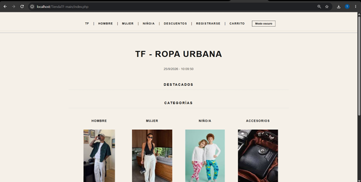

### Plantillas compartidas

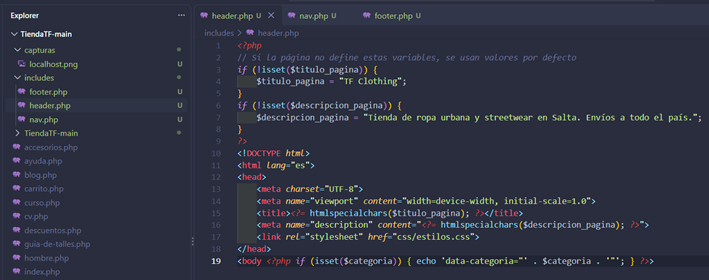

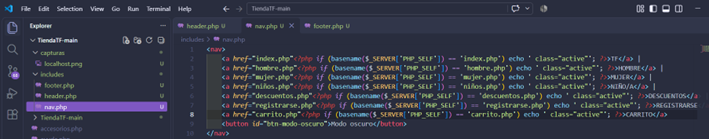

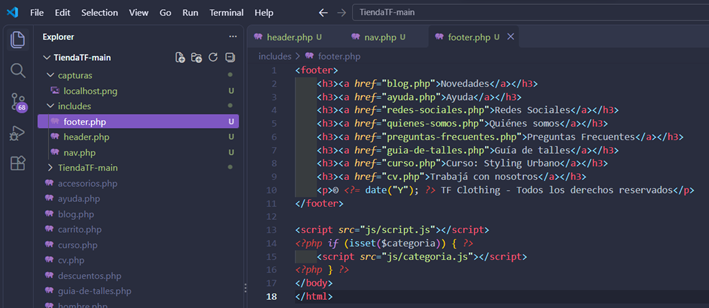

### Integración en la página de inicio

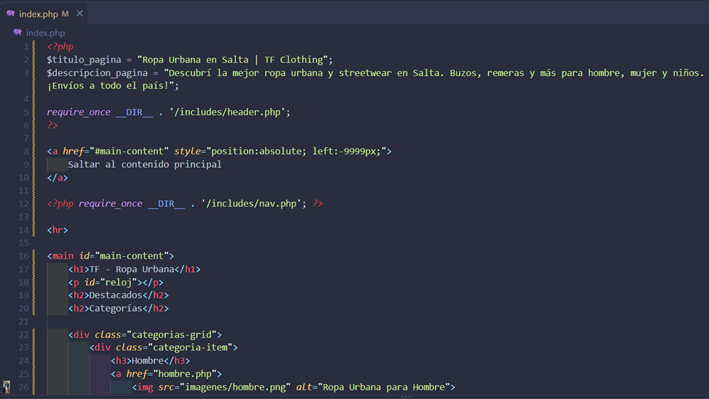

### Navegación dinámica

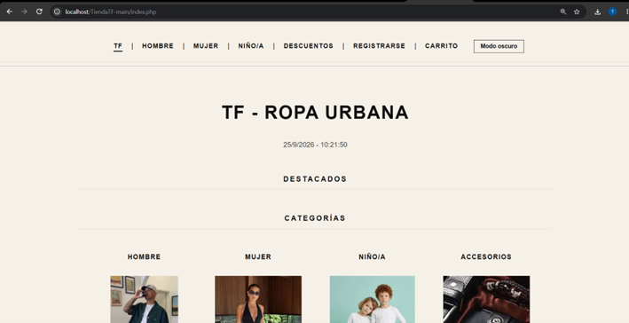

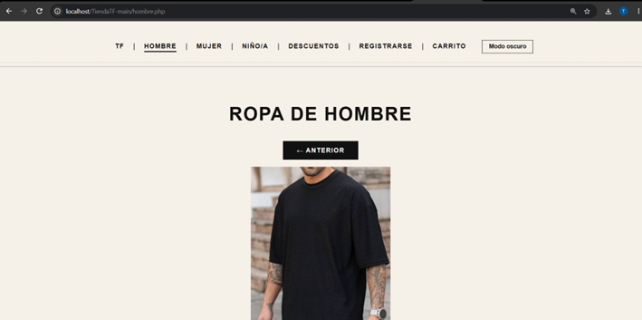

### Plantilla de configuración

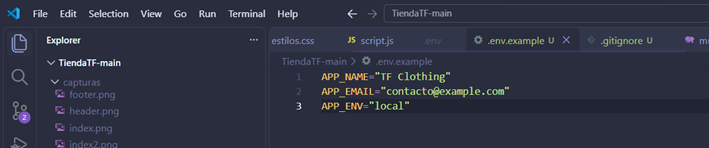

## Control de versiones

La migración se trabajó en la rama feature/migracion-php-ssi,
con commits separados para las plantillas, su integración y la configuración.

## Clase 5 — Procesamiento de formularios y seguridad web

Incorporé dos formularios al sitio:

- **Contacto (POST):** recibe nombre, correo electrónico y mensaje. Valida los campos obligatorios y el formato del correo. Si hay errores, muestra los mensajes y conserva los datos ingresados. Si los datos son válidos, muestra una confirmación y un resumen.
- **Buscador de productos (GET):** recibe la búsqueda mediante el parámetro `q` y muestra las prendas que coinciden, con su imagen y categoría. Informa cuando la búsqueda está vacía o no encuentra resultados.

El desarrollo de esta entrega está dentro de la carpeta `clase5`.

### Validación y prevención de XSS

Los datos recibidos se comprueban y se limpian con `trim()`. El correo se valida con `filter_var()` y `FILTER_VALIDATE_EMAIL`.

Antes de mostrar los datos en HTML se utiliza `htmlspecialchars()` mediante la función `escapar()`. Así, las etiquetas ingresadas aparecen como texto y no se interpretan como código.

El formulario de contacto procesa los datos para esta demostración; no envía correos ni los guarda en una base de datos.

### Ejecución local

Con Apache iniciado en XAMPP:

- Contacto: http://localhost/TiendaTF-main/clase5/contacto.php
- Buscador: http://localhost/TiendaTF-main/clase5/buscar.php

### Capturas de funcionamiento

#### Contacto: validación y conservación de los campos

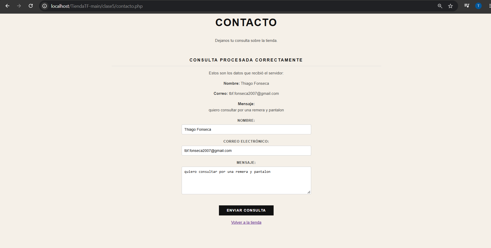

#### Contacto: prueba de XSS

El mensaje con la etiqueta `<script>` se muestra como texto.

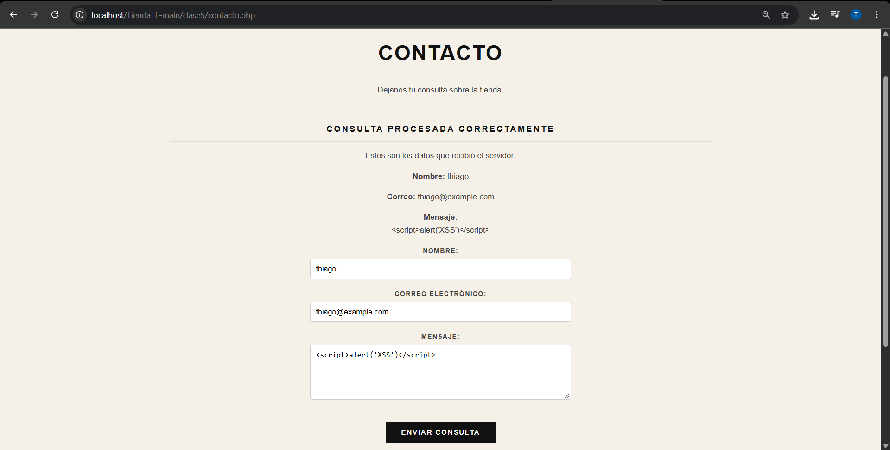

#### Buscador: resultados por GET

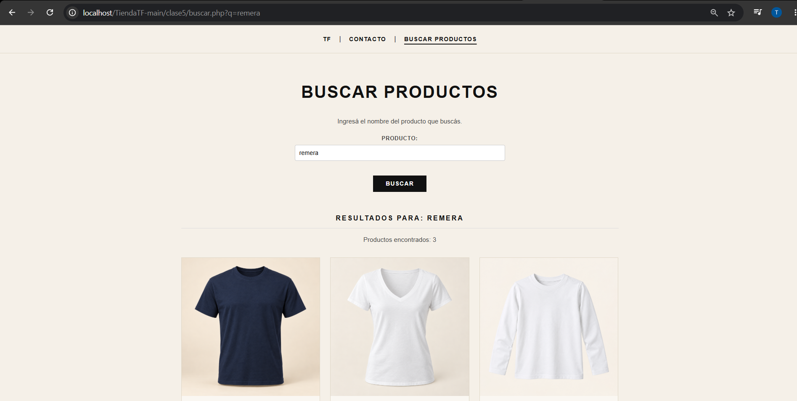

#### Buscador: validación de búsqueda vacía

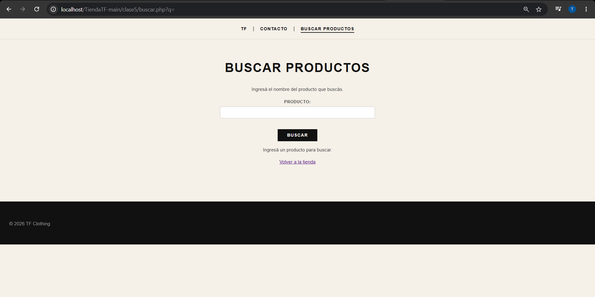

## Clase 7 - Persistencia y conexión PHP-MySQL

Agregué un módulo de gestión de productos conectado con PDO a la base `tf_tienda_tp6`. Desde la página se pueden listar y buscar productos, agregar uno nuevo, editar sus datos y eliminarlo después de confirmar.

El módulo usa la tabla `productos` y sus categorías del TP6, junto con el encabezado, el menú, el pie y los estilos de TF.

Todas las consultas usan `prepare()` y `execute()` con parámetros. Los datos mostrados pasan por `escapar()`, que utiliza `htmlspecialchars()`. Las modificaciones se envían mediante POST y se validan en PHP. Los errores internos se registran sin mostrarlos completos en la página.

### Ejecución local del TP7

1. Iniciar Apache y MySQL en XAMPP.
2. Tener cargada la base del TP6. Si es una instalación nueva, importar primero `tp6/schema.sql` y después `tp6/consultas.sql`, una vez.
3. Copiar `.env.example` como `.env` y completar los datos de conexión del equipo.
4. Abrir http://localhost/TiendaTF-main/admin/index.php o entrar desde Gestión de productos en el pie del sitio.

Para demostrarlo se puede crear un producto de práctica, cambiar su precio y eliminarlo desde la interfaz. Los cambios se pueden comprobar en phpMyAdmin. Un producto con pedidos asociados no se puede borrar; se informa esa restricción y se permite editar su estado.

El desarrollo y las pruebas están explicados en [tp7/README.md](tp7/README.md). La pantalla de comprobación está en http://localhost/TiendaTF-main/tp7/prueba_conexion.php.

## Catálogo y compra

El catálogo comparte los productos de MySQL con Gestión de productos. El cliente puede armar su carrito y registrar un pedido con retiro en tienda y pago al retirar. Los pedidos recibidos se consultan desde Gestión de productos.

El recorrido, los archivos y la actualización de la base están explicados en [Catálogo y pedidos](tienda/README.md). La actualización ya está aplicada en el entorno local. Para otro equipo hay que seguir ese orden de instalación después del TP6.

## TP8 - Sesiones y autenticación

El registro guarda usuarios con contraseña hasheada. El login verifica la contraseña con password_verify(), regenera el identificador de sesión y permite entrar según el rol. Mi cuenta y Mis pedidos requieren sesión; Gestión de productos y el listado general de pedidos requieren administrador. El cierre de sesión elimina los datos y su cookie.

Se ingresa desde el icono de cuenta o Iniciar sesión en el pie de la tienda. La explicación paso a paso, la preparación del administrador y las pruebas están en [TP8](tp8/README.md).
